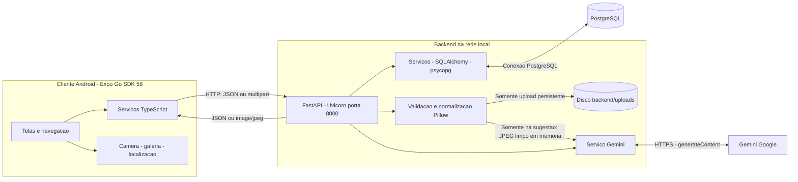
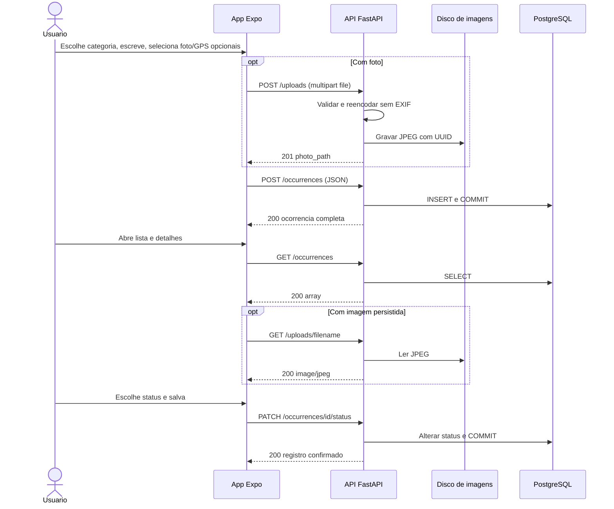

# EcoMap — levantamento técnico para a documentação da APS

**Destinação:** subsídio factual à APS de Ciência da Computação, 7º/8º semestre, UNIP, disciplina Sistemas Distribuídos, conforme contexto fornecido pelo solicitante.

**Data da análise:** 24 de outubro de 2026. **Referência de código:** branch `desenvolvimento/foto-gps`, commit `1edfd77`. A árvore estava limpa antes deste levantamento; o único novo arquivo produzido é este relatório. Nenhum commit, instalação, alteração de configuração, migração ou acesso ao banco real foi realizado nesta análise.

## Critérios de evidência e uso deste documento

O levantamento confronta fontes e configurações, documentação local, testes e histórico Git. O README permanece majoritariamente como material do template Expo e não foi tomado como especificação do EcoMap. `docs/foto-gps.md` contém referências históricas a SDK 57, Node antigo e IPs anteriores: os valores atuais abaixo foram conferidos no código e nas dependências instaladas. `docs/status.md` e `docs/gemini.md` complementam os contratos.

São usados quatro níveis de evidência:

- **Confirmado no código/ambiente:** verificável nos arquivos, dependências locais ou comandos executados nesta análise.
- **Relatado pelo usuário/documentado:** validação manual no Expo Go e histórico de operação; não representa um novo ensaio de hardware ou consulta ao PostgreSQL nesta análise.
- **Interpretação técnica:** motivação, público potencial e implicações arquiteturais coerentes com o programa, sem constituir pesquisa de campo.
- **Não confirmado:** informação que depende de dados acadêmicos, ambiente privado, infraestrutura ou medições não disponíveis.

O relatório é uma base extensa de consulta, não uma declaração de conformidade com um manual UNIP que não foi disponibilizado. A paginação, a capa, a identificação do grupo, as citações e a ficha de atividades devem ser ajustadas ao roteiro oficial da instituição. Não foram inventados participantes, horas trabalhadas, estatísticas ambientais, resultados de desempenho ou bibliografia de livros não consultados.

## Sumário

1. Objetivo e motivação
2. Introdução e delimitação do sistema
3. Fundamentos e tecnologias móveis utilizadas
4. Plano de desenvolvimento e requisitos
5. Projeto: estrutura, arquitetura, banco, contratos e módulos
6. Relatório de linhas e trechos de código
7. Apresentação, funcionamento, testes e resultados
8. Referências técnicas e bibliográficas
9. Ficha cronológica das atividades
10. Dados pendentes para preenchimento
11. Informações não confirmadas

## 1. Objetivo e motivação

### 1.1 Objetivo geral

O **EcoMap** é um aplicativo móvel de registro e acompanhamento de ocorrências ambientais urbanas. Permite informar categoria e descrição, anexar opcionalmente uma fotografia e coordenadas, consultar ocorrências persistidas e atualizar seu status. A assistência Gemini é opcional e ajuda a sugerir categoria, melhorar a redação e elaborar uma descrição a partir de uma foto.

No recorte acadêmico de Sistemas Distribuídos, demonstra a cooperação entre cliente móvel, API em outro processo/computador, persistência relacional e um serviço externo de IA. A fotografia fica no sistema de arquivos do backend; a referência e as coordenadas ficam no banco. Essa separação é parte efetiva do projeto.

### 1.2 Problema abordado e motivação

As três categorias operacionais são **Calçada**, **Árvore** e **Área verde**. O registro reúne relato, imagem e posição para tornar uma observação consultável por outros clientes da mesma API. A motivação técnica é facilitar a documentação de situações percebidas no espaço urbano e demonstrar comunicação e persistência entre componentes independentes.

É razoável apresentar o aplicativo como ferramenta de apoio à participação e ao registro ambiental, mas não afirmar que ele reduziu danos, melhorou indicadores ambientais ou foi adotado por uma prefeitura: não há pesquisa ou medição que sustente esses resultados. Atualizar para “Resolvida” é uma declaração do usuário, não comprovação de uma intervenção física.

### 1.3 Público e cenários sustentados

**Interpretação técnica:** moradores, estudantes e observadores de situações urbanas podem registrar e acompanhar relatos em uma implantação controlada. Não há cadastro de usuários, vínculo institucional, perfis, equipes de atendimento ou integração municipal implementados.

Exemplos de uso coerentes: registrar uma condição visível em uma calçada, relatar uma situação envolvendo uma árvore ou documentar uma área verde; consultar a fotografia e as coordenadas registradas; alterar o status de uma ocorrência após avaliação manual. O sistema não prova a autenticidade, autoria ou localização real de um relato.

## 2. Introdução e delimitação do sistema

### 2.1 Visão distribuída

O celular executa a interface React Native no Expo Go. O computador disponibiliza o FastAPI pela rede local; o backend consulta PostgreSQL e utiliza seu próprio disco para imagens. Quando solicitado, o backend faz uma chamada HTTPS à API Gemini do Google. O celular não recebe a chave do provedor e não conversa diretamente com o PostgreSQL.

As fronteiras de rede introduzem indisponibilidade e resultados ambíguos: uma operação pode ser persistida pelo servidor, mas a resposta não chegar ao celular. O projeto trata carregamento, falhas e novas tentativas, sem prometer execução “exatamente uma vez”. A rede é usada por chamadas HTTP de requisição/resposta; não há fila de mensagens, broker, WebSocket, replicação de banco ou processamento distribuído de jobs.

Os módulos FastAPI constituem uma única aplicação backend organizada em camadas. Separar arquivos em rotas, serviços, modelos e configuração **não equivale a implementar microsserviços**. O Gemini é uma dependência externa opcional; não é um modelo treinado ou hospedado pelo grupo.

### 2.2 Escopo efetivamente entregue

| Implementado | Evidência principal |
| --- | --- |
| Cadastro com categoria escolhida explicitamente e descrição obrigatória | `src/app/register.tsx` |
| Foto opcional da galeria ou câmera, prévia e remoção | `src/hooks/use-occurrence-evidence.ts` |
| Localização pontual opcional, permissões e timeout | mesmo hook |
| Upload validado e download da imagem persistida | `backend/uploads.py`, `backend/routes.py` |
| Listagem, detalhes por ID e tratamento distinto de vazio/erro | `src/app/occurrences.tsx`, `src/app/details.tsx` |
| Resumo com contadores reais | `src/services/occurrences.ts`, `src/app/index.tsx` |
| Atualização persistente dos três status | schemas, serviços e rota PATCH |
| Categoria, melhoria textual e descrição de imagem por IA, sempre revisáveis | serviços Gemini e formulário |
| Migração incremental manual, testes e configuração centralizada | `backend/migrate.py`, testes e configurações |

### 2.3 Fora do escopo ou ausente

Não foram encontrados autenticação, autorização, registro de autores, mapa interativo, geocodificação/endereço postal, filtro por proximidade, notificações, painel administrativo, comentários, edição geral, exclusão de ocorrências, múltiplas fotos por ocorrência, histórico de status, timestamps de criação, cache offline ou sincronização automática offline.

Embora a listagem diga “na sua região”, **GET /occurrences retorna todas as ocorrências**, sem filtro espacial. O nome EcoMap não significa que exista um mapa. Há código para web e iOS herdado do template, mas a validação de dispositivo relatada refere-se ao Android com Expo Go SDK 58. Não foi comprovada publicação em loja, geração de APK/AAB, uso de EAS ou implantação pública.

## 3. Fundamentos e tecnologias móveis utilizadas

### 3.1 Linguagens e ambiente de desenvolvimento

| Item | Versão confirmada | Papel/evidência |
| --- | --- | --- |
| Node.js | 24.22.1 | Execução de ferramentas Expo, testes e lint; `node --version` |
| npm | 11.19.1 | Manifest e lockfile npm; `npm.cmd --version` |
| TypeScript | 6.0.3 | Código `.ts/.tsx`, modo estrito e verificação estática |
| React | 19.3.0 | Componentes, estado, callbacks e referências |
| React Native | 0.88.0 | Interface e integração móvel |
| Expo | 58.0.19 | SDK e ferramentas para execução móvel |
| Expo Router | 58.0.26 | Rotas por arquivos e navegação Stack |
| Python | 3.11.9 | Ambiente virtual local do backend e testes |
| Git | Versão não levantada | Histórico e consolidação; não é uma função do aplicativo |
| VS Code/PowerShell | Versões não levantadas | Ambiente informado pelo usuário e shell utilizado na análise |

Versões dos pacotes foram conferidas nos manifests, lockfile e metadados locais. O projeto não precisa de Bun: há `package-lock.json` e não foi localizado `bun.lock`. O PowerShell local bloqueava os wrappers `.ps1` do npm em etapas anteriores; os comandos `.cmd` funcionam sem mudar a política de execução.

### 3.2 Fundamentos de interface, tipagem e navegação

React organiza a interface em componentes que recebem propriedades e mantêm estado. No EcoMap, `useState` representa dados e estados de carregamento; `useRef` guarda bloqueios síncronos de envios e versões de solicitações. Essas referências ajudam a bloquear cliques duplicados antes de uma nova renderização e a descartar respostas antigas.

React Native fornece `View`, `Text`, `TextInput`, `TouchableOpacity`, `Image`, `ScrollView`, `Alert` e indicadores de atividade. As telas do domínio utilizam `StyleSheet`, cores escuras, botões e cartões; não foi identificado um framework de componentes de formulário substituindo esses elementos. Os arquivos `.web.tsx` são variantes para web; isso não prova equivalência funcional entre plataformas.

TypeScript fornece contratos de compilação, mas respostas HTTP ainda chegam como dados não confiáveis. Por isso os serviços usam verificações em tempo de execução antes de aceitar listas, ocorrências e sugestões. A configuração `strict: true` e os aliases `@/*`/`@/assets/*` constam em `tsconfig.json`.

O Router resolve telas em `src/app`. `_layout.tsx` usa `Stack`, cabeçalhos ocultos e `ThemeProvider` com tema escuro. `useFocusEffect` recarrega início, listagem e detalhes quando recebem foco; não há atualização push entre celulares. Há splash animada de origem Expo em `AnimatedSplashOverlay`, chamada pelo layout. [Fundamentos React Native](https://reactnative.dev/docs/getting-started), [TypeScript](https://www.typescriptlang.org/docs/) e [Expo Router](https://docs.expo.dev/router/introduction/) são referências oficiais complementares; os comportamentos descritos aqui derivam do código local.

### 3.3 Dependências frontend diretas

A tabela abaixo registra versões **instaladas**. Estar no manifest não significa que toda biblioteca esteja envolvida nos fluxos de domínio: parte atende componentes de demonstração ou suporte do template.

| Pacote | Versão instalada | Grupo |
| --- | --- | --- |
| `@expo/ui` | 58.0.23 | Runtime/dependencia direta |
| `expo` | 58.0.19 | Runtime/dependencia direta |
| `expo-constants` | 58.0.13 | Runtime/dependencia direta |
| `expo-device` | 58.0.5 | Runtime/dependencia direta |
| `expo-file-system` | 58.0.11 | Runtime/dependencia direta |
| `expo-font` | 58.0.10 | Runtime/dependencia direta |
| `expo-glass-effect` | 58.0.5 | Runtime/dependencia direta |
| `expo-image` | 58.0.17 | Runtime/dependencia direta |
| `expo-image-picker` | 58.0.10 | Runtime/dependencia direta |
| `expo-linking` | 58.0.14 | Runtime/dependencia direta |
| `expo-location` | 58.0.19 | Runtime/dependencia direta |
| `expo-router` | 58.0.26 | Runtime/dependencia direta |
| `expo-splash-screen` | 58.0.11 | Runtime/dependencia direta |
| `expo-status-bar` | 58.0.4 | Runtime/dependencia direta |
| `expo-symbols` | 58.0.4 | Runtime/dependencia direta |
| `expo-system-ui` | 58.0.6 | Runtime/dependencia direta |
| `expo-web-browser` | 58.0.6 | Runtime/dependencia direta |
| `react` | 19.3.0 | Runtime/dependencia direta |
| `react-dom` | 19.3.0 | Runtime/dependencia direta |
| `react-native` | 0.88.0 | Runtime/dependencia direta |
| `react-native-gesture-handler` | 3.3.0 | Runtime/dependencia direta |
| `react-native-reanimated` | 4.7.1 | Runtime/dependencia direta |
| `react-native-safe-area-context` | 5.10.1 | Runtime/dependencia direta |
| `react-native-screens` | 4.30.0 | Runtime/dependencia direta |
| `react-native-web` | 0.21.4 | Runtime/dependencia direta |
| `react-native-worklets` | 0.13.0 | Runtime/dependencia direta |
| `@types/react` | 19.3.0 | Desenvolvimento |
| `eslint` | 9.39.5 | Desenvolvimento |
| `eslint-config-expo` | 58.0.4 | Desenvolvimento |
| `typescript` | 6.0.3 | Desenvolvimento |

Papéis principais: ImagePicker abre galeria/câmera; Location solicita posição em primeiro plano; FileSystem cria um `File` real para multipart; `expo/fetch` transporta as requisições; SplashScreen/Image/Reanimated/Worklets apoiam a abertura animada; Router/Screens/SafeArea/GestureHandler compõem a infraestrutura de navegação e renderização. Font, Symbols e componentes tematizados também aparecem no material inicial. React DOM e React Native Web atendem a plataforma web. Não há evidência de uso de todas as dependências de suporte em cada tela.

As APIs utilizadas são compatíveis com a documentação versionada do [Expo SDK 58](https://docs.expo.dev/versions/v58.0.0/). As referências específicas são [ImagePicker](https://docs.expo.dev/versions/v58.0.0/sdk/imagepicker/), [Location](https://docs.expo.dev/versions/v58.0.0/sdk/location/) e [FileSystem](https://docs.expo.dev/versions/v58.0.0/sdk/filesystem/).

### 3.4 Backend e persistência

| Tecnologia | Versão instalada/pin direto | Função real |
| --- | --- | --- |
| FastAPI | 0.143.0 | Aplicação ASGI, validação e rotas HTTP |
| Uvicorn | 0.54.0 | Servidor ASGI do comando de execução |
| SQLAlchemy | 2.1.4 | ORM, engine, sessão e transações |
| psycopg, extra binary | 3.3.6 | Driver de comunicação com PostgreSQL |
| python-dotenv | 1.2.4 | Leitura da configuração privada do backend |
| Pydantic | 2.13.5 | Schemas e validações de entrada/saída da IA |
| python-multipart | 0.0.32 | Parser multipart para fotografias |
| Pillow | 13.0.0 | Inspeção, orientação, redução e reencodificação da imagem |
| Starlette | 1.7.0, transitiva | Infraestrutura ASGI, respostas e thread pool |
| PostgreSQL | Versão do servidor não confirmada | Persistência relacional real, relatada e documentada |
| SQLite | Versão não levantada | Banco descartável em memória usado somente nos testes backend |

O arquivo `backend/requirements.txt` fixa as oito dependências diretas. Gemini é acessado por `urllib.request`, `json`, `base64` e outras bibliotecas padrão do Python; não foi adicionado SDK Google específico. A conexão ORM não é usada nas rotas de sugestão.

## 4. Plano de desenvolvimento e requisitos

### 4.1 Plano reconstruído a partir das evidências

O histórico sustenta desenvolvimento incremental: base Expo; telas e backend inicial; separação em camadas e API central; foto/GPS com migração não destrutiva; correções de multipart e comunicação; contadores; status; SDK 58; assistência Gemini; categoria conscientemente selecionada; consolidação e documentação. Trata-se de **reconstrução**, não de prova de que um cronograma formal tenha sido produzido antes da implementação.

Cada incremento preservou os endpoints existentes quando possível e acrescentou testes. A estratégia permitiu validar primeiro o cadastro manual e depois adicionar recursos opcionais. A migração foi separada da inicialização para evitar alterações automáticas no banco. Os quatro últimos commits organizaram mudanças que haviam sido desenvolvidas e validadas antes; seus horários não representam a duração do trabalho.

### 4.2 Requisitos funcionais confirmados

| ID | Requisito | Critério observável na implementação |
| --- | --- | --- |
| RF01 | Registrar ocorrência | Categoria e descrição não vazias; POST retorna registro com ID |
| RF02 | Exigir escolha consciente de categoria | Estado inicial vazio; alerta bloqueia envio; reseta após sucesso |
| RF03 | Selecionar/tirar foto opcional | Prévia, cancelamento e remoção; erro não exige usar foto |
| RF04 | Obter coordenadas opcionais | Permissão em primeiro plano, indicador, verificação do serviço e timeout |
| RF05 | Armazenar foto válida e referenciá-la | POST /uploads retorna caminho; cadastro envia caminho, não URI do celular |
| RF06 | Listar registros persistidos | GET /occurrences com estados distintos de carga, vazio e falha |
| RF07 | Consultar detalhes | Recebe ID pela navegação e localiza item da lista recebida |
| RF08 | Atualizar status | PATCH exclusivo, três valores, 404/422 e confirmação após sucesso |
| RF09 | Exibir contadores reais | Total de registros e contagens dos status Em análise/Resolvida |
| RF10 | Sugerir categoria | Só muda a categoria após “Usar sugestão” |
| RF11 | Melhorar descrição textual | Prévia, aceitar/ignorar, campo permanece editável |
| RF12 | Sugerir descrição por imagem | Confirmação externa, imagem limpa, prévia e aceite explícito |
| RF13 | Recarregar e recuperar falhas | Recarga por foco, tentativa manual e descarte de respostas antigas |

### 4.3 Requisitos não funcionais e alcance das evidências

| Aspecto | Mecanismo efetivo | Limitação/evidência faltante |
| --- | --- | --- |
| Manutenibilidade | Camadas, tipos e configuração central | Sem medição de complexidade ou produtividade |
| Usabilidade | Prévia, mensagens, carregamento e aceite humano | Sem avaliação formal de usuários/acessibilidade |
| Robustez de rede | AbortController, timeouts, validação de JSON e retry manual | Sem modo offline ou garantia de disponibilidade |
| Integridade | Pydantic, commit/rollback no status e migração transacional | Sem versionamento concorrente ou trilha de auditoria |
| Privacidade | Segredo só no backend; remoção de EXIF; confirmação de foto | Conteúdo visual/textual pode conter dados pessoais; sem prova formal LGPD |
| Controle de arquivos | Limites de bytes/pixels, UUID, caminho restrito | Sem quota por usuário ou limpeza de órfãos |
| Portabilidade | Expo, React Native e variantes web | Android validado por relato; iOS/web não validados nesta análise |
| Desempenho | Redução da imagem e operações de imagem/rede fora do event loop | Sem benchmarks, carga, SLA ou latência mensurada |

Não apresentar segurança de produção, alta disponibilidade, escalabilidade horizontal ou processamento em tempo real como requisitos já atendidos. São necessidades futuras, não funcionalidades concluídas.

## 5. Projeto: estrutura, arquitetura, banco, contratos e módulos

### 5.1 Estrutura resumida

```text
EcoMap/
├── src/
│   ├── app/                 # _layout, index, register, occurrences, details, explore
│   ├── config/api.ts        # URL única da API
│   ├── services/            # http, occurrences, photos, categories, descriptions
│   ├── types/               # occurrence, evidence, description-suggestion
│   ├── hooks/               # evidências, tema e esquema de cores
│   ├── components/          # splash, componentes de tema, abas e exemplos
│   ├── constants/theme.ts
│   └── global.css
├── backend/
│   ├── main.py              # ponto de entrada ASGI
│   ├── config.py            # ambiente e GeminiSettings
│   ├── database.py          # engine, SessionLocal, Base
│   ├── models.py            # Occurrence
│   ├── schemas.py           # contratos Pydantic
│   ├── routes.py            # nove endpoints do domínio/API
│   ├── services.py          # persistência e serialização
│   ├── uploads.py           # imagem, referência e disco
│   ├── upload_limits.py     # limite de corpo multipart
│   ├── gemini_service.py    # transporte e validação Gemini
│   ├── migrate.py
│   ├── migrations/001_add_photo_location.sql
│   ├── tests/               # test_photo_gps.py e test_gemini.py
│   └── requirements.txt
├── scripts/                 # testes Node e script de reset do template
├── docs/                    # foto-gps, status, gemini e este levantamento
├── assets/                  # ícones, splash e imagens do template
├── app.json
├── package.json / package-lock.json
├── tsconfig.json / eslint.config.js
├── .gitignore
└── README.md / LICENSE / AGENTS.md / CLAUDE.md
```

O backend tem diretórios locais `.venv` e `uploads` e configuração `.env` que não devem ser versionados; não são fontes públicas do projeto. A árvore acima não transcreve seu conteúdo. Não há diretórios nativos `android/ios` versionados nem configuração EAS identificada.

### 5.2 Responsabilidades e dependências

| Módulo/camada | Responsabilidade e funções representativas |
| --- | --- |
| `src/app` | Interface e navegação; HomeScreen, RegisterScreen, OccurrencesScreen, DetailsScreen |
| `services/http.ts` | `requestJson`: URL central, envio, timeout, HTTP, JSON e mensagem de rede |
| `services/occurrences.ts` | `getOccurrences`, `createOccurrence`, `updateOccurrenceStatus`, `summarizeOccurrences` e validação runtime |
| `services/photos.ts` | `createPhotoFormData`, `uploadPhoto`, `getPhotoUrl`; File/Blob real |
| `services/categories.ts` | `suggestCategory`: contrato de categoria e normalização da resposta aceita |
| `services/descriptions.ts` | `describePhoto`, `improveDescription`, `parseSuggestion` |
| `use-occurrence-evidence.ts` | Estado da foto/coordenadas, `selectPhoto`, `locate`, remoção e permissões |
| `backend/main.py` | FastAPI, middleware CORS, limite de upload e inclusão do router |
| `backend/config.py` | `DATABASE_URL`, `GeminiSettings`, `get_gemini_settings`; não contém chave literal |
| `backend/database.py` | Conexão PostgreSQL e fábrica de sessões SQLAlchemy |
| `backend/models.py` | Mapeamento da única tabela de domínio `occurrences` |
| `backend/schemas.py` | Entradas de cadastro/status/IA e respostas de sugestão |
| `backend/services.py` | Consultar, criar, serializar e atualizar somente status, fechando sessões |
| `backend/uploads.py` | `normalize_image`, `read_normalized_photo`, `write_photo`, `resolve_photo_path` |
| `backend/gemini_service.py` | Três operações sobre `_suggest`, HTTP Google e fallback sanitizado |
| Testes | Frontend simulado e endpoints ASGI com banco temporário; não são código de produção |

As dependências centrais seguem telas → serviços frontend → requestJson → API → schemas/serviços → ORM → PostgreSQL. O módulo de imagens é compartilhado por upload persistente e análise temporária da IA. `schemas.py` importa o padrão de caminho de `uploads.py`; `database.py` importa a configuração central. Não há injeção de dependência de banco por request FastAPI: os serviços instanciam e fecham `SessionLocal` diretamente.

`explore.tsx` e componentes como `app-tabs`, `themed-*`, `hint-row`, `collapsible` e `web-badge` preservam exemplos/suporte do template. O layout real é Stack: não é correto descrever as abas de exemplo como navegação principal do EcoMap. O splash ainda usa recursos visuais Expo. O script `reset-project.js` move ou remove diretórios; é utilitário do template, não etapa de execução, e **não deve ser executado para iniciar ou apresentar o EcoMap**.

### 5.3 Arquitetura e protocolos



Na rota de IA, o arquivo é normalizado e entregue diretamente ao serviço Gemini, sem leitura do diretório de uploads nem persistência permanente. A rota textual chega ao serviço Gemini sem passar pelo processamento de imagem.

A base atual é `http://192.168.10.9:8000`, em `src/config/api.ts`. É um endereço privado de demonstração, não um domínio público. A base vale para ocorrências, IA, uploads e composição da URL de imagem. `0.0.0.0` no Uvicorn significa escutar interfaces; não é o endereço que o celular deve usar. `localhost` no telefone aponta para o próprio telefone.

O frontend usa HTTP com JSON nos dados e `multipart/form-data` nas imagens. O download devolve JPEG. Backend e Google comunicam-se por HTTPS, com chave no cabeçalho `x-goog-api-key`. SQLAlchemy/psycopg acessam o protocolo PostgreSQL pela configuração privada; não foi confirmada a topologia física entre servidor de banco e API nem a configuração TLS dessa conexão. Metro serve o aplicativo durante desenvolvimento; um túnel Metro não publica automaticamente o FastAPI.

HTTP oferece semântica de métodos e códigos; JSON permite trocar dados textuais entre TypeScript e Python. Esses fundamentos podem ser discutidos a partir de [RFC 9110](https://www.rfc-editor.org/rfc/rfc9110.html) e [RFC 8259](https://www.rfc-editor.org/rfc/rfc8259.html), sem afirmar uma versão específica de HTTP negociada em todos os enlaces.

### 5.4 Banco e ciclo de vida dos dados

**Fonte:** `models.py`, `services.py`, schemas e migração. O banco `ecomap` e a persistência PostgreSQL são confirmados pelo histórico/documentação operacional e pelo usuário; este levantamento não abriu conexão para consultar catálogo, contagem, esquema SQL efetivo ou versão do servidor. O modelo representa uma única tabela, sem relacionamentos.

| Campo em `occurrences` | Tipo ORM / tipo SQL esperado | Obrigatoriedade e comportamento |
| --- | --- | --- |
| `id` | Integer / INTEGER | Chave primária; `index=True`; ID retornado após commit/refresh |
| `category` | String / VARCHAR sem tamanho declarado | NOT NULL; serviço utiliza texto recebido |
| `description` | String / VARCHAR sem tamanho declarado | NOT NULL; descrição do usuário ou sugestão aceita |
| `status` | String / VARCHAR sem tamanho declarado | NOT NULL; default ORM Registrada; serviço define Registrada ao criar |
| `latitude` | Double / DOUBLE PRECISION | NULL permitido |
| `longitude` | Double / DOUBLE PRECISION | NULL permitido |
| `photo_path` | String / VARCHAR | NULL permitido; caminho relativo, não bytes |

Não há tabelas de usuários/categorias, chaves estrangeiras, vínculo institucional, data/hora ou histórico de alterações. As três categorias e os três status não são enums SQL demonstrados pelo modelo. O PATCH valida status por Pydantic Literal; o cadastro backend valida categoria apenas como texto não vazio, enquanto o formulário e a IA usam as três categorias canônicas. Restrições de latitude/longitude/par e formato de caminho são de aplicação, não CHECK constraints declaradas no modelo.

O modelo declara PK/índice de ID, mas não confirma o nome físico de índices, sequência/identity, proprietário ou schema do banco já existente. Não se deve inventar um DDL completo como se fosse obtido do servidor. As consultas SQL não qualificam um schema; o `search_path` efetivo não foi inspecionado.

`get_occurrences` abre sessão, consulta `.all()`, serializa sete campos e fecha a sessão. Não há ordenação nem paginação explícitas. `create_occurrence` verifica a existência do arquivo referido, cria o objeto, executa `commit` e `refresh`, e fecha a sessão. O status tem rollback explícito em `SQLAlchemyError` e retorna erro sanitizado. A criação não tem o mesmo tratamento sanitizado específico de falhas de banco.

A foto persistida é um JPEG com nome UUID hexadecimal gerado pelo servidor. O banco guarda `/uploads/<32 caracteres hexadecimais>.jpg`; a URI `file://` do celular nunca é referência definitiva. `getPhotoUrl` junta caminho e base HTTP. Cada ocorrência comporta no máximo uma referência de foto. O arquivo não recebe FK nem participa de uma transação distribuída com o registro SQL.

O aplicativo sobe a foto antes de criar a ocorrência. Se o cadastro falhar, pode sobrar imagem órfã; o mesmo formulário reutiliza um upload bem-sucedido pela URI. Não há exclusão/limpeza automática, expiração nem política de retenção implementadas. Backup precisa preservar **banco e uploads juntos**; só restaurar PostgreSQL não recupera os bytes das imagens.

#### Migração identificada

`001_add_photo_location.sql` adiciona somente latitude, longitude e photo_path opcionais, com `SET LOCAL lock_timeout = '5s'`. `migrate.py` exige `--apply`, executa o arquivo dentro de `engine.begin()`, trata falha sem expor informações de conexão e dispõe o engine. Não contém IF NOT EXISTS: se uma coluna já existir, a migração falha e a transação é revertida, em vez de reaplicar silenciosamente.

O SQL não remove nem atualiza linhas. A documentação local registra aplicação após backup custom e restauração de teste, preservando dois registros existentes naquela etapa; isso é evidência histórica, não contagem atual. Depois o usuário relatou três ocorrências e persistência após reinício. Não houve nova inspeção do banco neste levantamento. Não se recomenda reaplicar a migração nesta instalação.

O servidor atual **não chama `create_all()` nem executa migrações na inicialização**. `Base.metadata.create_all()` não modifica automaticamente a estrutura de tabelas existentes; a existência de modelos atualizados não substitui migração. Não há Alembic ou migração de criação inicial completa identificados. Uma instalação nova precisa de preparação explícita do banco compatível; não basta supor que iniciar Uvicorn criará todas as tabelas.

### 5.5 Endpoints reais e contratos

Há nove endpoints definidos em `backend/routes.py`. Os corpos de ocorrência têm os campos `id`, `category`, `description`, `status`, `latitude`, `longitude`, `photo_path`. Os três últimos podem ser null em registros sem evidências.

| Método e rota | Entrada | Sucesso | Erros/comportamento relevante |
| --- | --- | --- | --- |
| GET `/` | Sem corpo | 200, `{"message":"EcoMap API funcionando"}` | Teste simples da API; não verifica banco ou Gemini |
| GET `/occurrences` | Sem filtros ou paginação | 200, array completo; `[]` se realmente vazio | Banco indisponível pode gerar 500; cliente distingue erro de vazio |
| POST `/occurrences` | JSON: category e description; latitude, longitude e photo_path opcionais | **200**, ocorrência completa; status inicial Registrada | 422 para validação; 404 para foto bem formada inexistente; falha não tratada especificamente pode gerar 500 |
| PATCH `/occurrences/{occurrence_id}/status` | ID inteiro e JSON `{"status":"Em análise"}` | 200, ocorrência completa atualizada | 404 inexistente; 422 ID não inteiro, status inválido/ausente ou campo extra; 500 sanitizado em erro SQLAlchemy |
| POST `/uploads` | Multipart, campo obrigatório `file` | **201**, `{"photo_path":"/uploads/<uuid>.jpg"}` | 422 sem arquivo; 415 formato/conteúdo; 413 bytes/pixels/corpo; 400 Content-Length inválido; 500 ao gravar |
| GET `/uploads/{filename}` | Nome restrito ao padrão UUID `.jpg` | 200, bytes `image/jpeg`, `X-Content-Type-Options: nosniff` | 422 nome inválido; 404 arquivo inexistente |
| POST `/occurrences/suggest-category` | JSON apenas description, 1 a 2000 caracteres, não branco | 200, category, reason e message | 422 entrada inválida/extra; falhas conhecidas do provedor são fallback 200 com category null |
| POST `/occurrences/improve-description` | Mesmo schema textual, só description | 200, description, reason e message | 422 entrada inválida; fallback 200 com description null |
| POST `/occurrences/describe-image` | Multipart `file`, mesma validação de imagem do upload | 200, description, reason e message; sem gravar imagem permanentemente | 422/415/413/400 de entrada e corpo; fallback Gemini 200 com description null |

Além das rotas do router, o FastAPI padrão disponibiliza GET `/openapi.json`, `/docs`, `/redoc` e `/docs/oauth2-redirect`. São recursos de documentação automática, não implementação de autenticação OAuth nem novas funções ambientais.

Não existem GET `/occurrences/{id}`, PUT de ocorrência ou DELETE. Os detalhes consultam a lista inteira e fazem `.find` pelo ID no cliente. A API oferece criação/leitura e atualização parcial do status; **não implementa CRUD completo**.

Exemplo exclusivamente ilustrativo de payload (não é cópia de um registro real):

```json
{"category":"Árvore","description":"Galho sobre a calçada.","latitude":0,"longitude":-46}
```

Coordenadas são opcionais, mas devem ser enviadas juntas quando presentes; zero é válido. Latitude aceita -90 a 90; longitude, -180 a 180, sem NaN/Infinity. Referência de foto deve seguir regex e existir no disco. Cadastro não recebe status para defini-lo livremente: o serviço define Registrada. O schema de criação não usa `extra="forbid"`, diferentemente de status e IA textual; não descrever uma rejeição geral de todos os extras no POST.

Não há uma máquina de estados restritiva: todos os três status podem substituir qualquer outro. Atualização concorrente não usa versão/ETag, portanto prevalece a última gravação confirmada. ID negativo ou zero é inteiro na rota de status e tende a resultar em 404 se não existir; a tela de detalhes exige ID positivo para consulta.

### 5.6 Fluxos de criação, consulta e status

1. O formulário inicia categoria vazia, descrição vazia, sem foto nem GPS. Categoria e descrição são obrigatórias; foto/GPS/IA não são.
2. A categoria é escolhida em botão ou por aceite explícito de sugestão. Não é preenchida automaticamente ao receber IA. Ignorar preserva a escolha existente.
3. O hook abre galeria/câmera, trata cancelamento e permissões, permite uma prévia e remoção. A câmera requer permissão; o seletor da galeria utilizado não solicita acesso amplo à biblioteca.
4. GPS solicita permissão em primeiro plano, verifica o serviço do aparelho e faz `getCurrentPositionAsync` com `Accuracy.High`, limitado por Promise.race a 20 segundos. O celular pode usar localização assistida do sistema; o código não comprova que cada posição veio exclusivamente de satélites. Não há rastreamento contínuo.
5. Registrar valida os campos, bloqueia duplicidade local e invalida sugestões antigas. Se houver foto, envia multipart com `File`/Blob real e recebe o caminho persistente.
6. O POST JSON contém categoria, descrição e evidências presentes. FastAPI/Pydantic validam, o serviço persiste e retorna o ID. A interface confirma e limpa categoria, descrição e evidências.
7. A listagem recarrega ao receber foco e separa carregamento, falha, lista vazia e dados. Selecionar item abre `/details?id=...`.
8. Os detalhes recarregam, localizam ID, exibem imagem ou mensagem de ausência/falha e coordenadas com seis casas ou “Não informada”. Não mostram mapa.
9. O status escolhido fica separado do confirmado. Apenas uma resposta válida do PATCH altera o estado confirmado; falhas preservam o anterior e permitem tentar de novo.
10. Ao voltar às telas, o foco dispara novas consultas. `Registradas = total de registros`, `Em análise = quantidade nesse status`, `Resolvidas = quantidade nesse status`. Não somar os três como categorias disjuntas, pois os dois últimos já estão incluídos no total.



O upload e o INSERT são duas operações distintas: não existe transação atômica envolvendo o disco e o PostgreSQL. Se um timeout ocorrer depois de um commit, reconsultar antes de repetir ajuda a verificar o resultado; não há chave de idempotência no cadastro.

### 5.7 Assistência Gemini

`config.py` lê `GEMINI_API_KEY`, `GEMINI_MODEL` e `GEMINI_TIMEOUT_SECONDS` do ambiente, com `.env` privado como fonte local e precedência das variáveis já existentes no processo. A chave é omitida do repr de GeminiSettings e enviada em cabeçalho, nunca incluída no frontend ou na URL pública. O host REST é fixo do Google; o nome do modelo deve obedecer a `gemini-[a-zA-Z0-9._-]+`.

**Modelo padrão confirmado no código:** `gemini-3.5-flash-lite`. **Modelo efetivamente configurado no ambiente privado:** não confirmado por este levantamento, pois o `.env` e seus valores não foram abertos. O usuário informa que o modelo configurado funciona. Não apresentar o padrão como prova do modelo efetivo, da gratuidade ou da disponibilidade futura.

As três operações compartilham `generateContent` REST, instrução de sistema, saída JSON, temperatura zero e máximo de 512 tokens. A leitura da resposta é limitada a 64 KiB. O timeout de I/O é configurável de 1 a 30 segundos, padrão 12; valores inválidos usam 12. Não há retries automáticos nem modelo alternativo automático. Esse timeout do transporte não constitui SLA global garantido de toda a operação.

| Função | O que sai do backend para o provedor | O que o usuário pode fazer |
| --- | --- | --- |
| Sugestão de categoria | Só descrição textual | Usar sugestão ou ignorar; manual continua disponível |
| Melhoria textual | Só texto original | Revisar, usar descrição, ignorar e editar |
| Descrição de foto | Instrução e JPEG normalizado inline/base64 | Confirmar envio externo antes da consulta, revisar e aceitar/ignorar |

A integração multimodal segue a API oficial de [entrada de imagens](https://ai.google.dev/gemini-api/docs/image-understanding) e [generateContent](https://ai.google.dev/api/generate-content). Não usa treinamento próprio, envio de GPS do formulário, histórico de conversas nem upload para Files API.

Na imagem, o servidor reutiliza a normalização: MIME e conteúdo JPEG/PNG/WebP, até 8 MiB e 20 milhões de pixels, orientação corrigida, thumbnail até 2048 × 2048, JPEG RGB novo com qualidade 85, sem EXIF/GPS/ICC. O nome original não é transmitido ao Google. O parser pode utilizar spool temporário; o arquivo é fechado após leitura. A rota de sugestão não grava a imagem no diretório permanente nem cria uma linha de ocorrência.

O prompt manda priorizar fidelidade visual sobre riqueza de detalhes, identificar observações diretas, separar suposições, descartar inferências, redigir e revisar cada afirmação. Na dúvida, omitir; não completar lacunas com linguagem especulativa. Não afirmar riscos, raízes, obstrução, danos, localização exata, causas ou consequências sem a evidência exigida; não mostrar etapas internas. Pede uma ou duas frases em português, máximo de 600 caracteres, ou description null sem problema identificável com confiança. Essas instruções **não garantem veracidade**.

Na melhoria textual, o prompt pede ortografia, clareza e concisão sem adicionar fatos, preservando significado e incertezas. Saída deve ser objeto com somente description, string não vazia até 600 caracteres ou null. O backend rejeita tipos inválidos, controles inadequados, JSON/estrutura inesperados e geração incompleta; normaliza espaços, sem truncar texto longo. Categoria é normalizada por acentos/caixa/espaços e aceita apenas as três canônicas.

Reasons de categoria: suggested, not_classified, unavailable, timeout, rate_limited, invalid_response. Reasons de descrição: suggested, not_identified e os mesmos quatro tipos de falha. Segurança do provedor pode resultar em ausência de sugestão. Quota 429 é distinguida; erros conhecidos retornam 200 de fallback com campo nulo e mensagem, não sugestão falsa. A UI não usa um 200 isolado como sinal de que houve sugestão.

O formulário solicita confirmação explícita para a foto, identifica Google como serviço externo e avisa que o conteúdo visível será enviado. Remover metadados **não anonimiza rostos, placas ou informações visíveis**. A política de retenção do provedor depende dos termos da conta, não foi auditada. O código não inclui a chave nos logs da integração.

Editar texto, iniciar troca/remoção da foto, sair da tela ou cadastrar invalida versões antigas da sugestão. Há bloqueios de chamadas duplicadas e prévia separada do campo editável. A IA não cadastra automaticamente e sua falha não impede cadastro manual.

### 5.8 Erros, segurança e consistência

| Mecanismo existente | Alcance e ressalva |
| --- | --- |
| `requestJson` | AbortController, `response.ok`, parsing JSON, mensagem de conexão e timeout; limpa timer |
| Timeouts no cliente | Padrão 15 s; cadastro 30 s; IA textual 35 s; upload/IA de foto 60 s |
| Validação runtime | Serviços rejeitam contratos inválidos em vez de retornar lista vazia artificial |
| Versão/flag de foco | Evita que respostas antigas sobrescrevam a tela atual; não cancela uma transação já feita no servidor |
| Foto no servidor | Limite de arquivo, pixels e corpo multipart (8 MiB + 64 KiB para overhead), inclusive sem Content-Length |
| Nome e caminho | UUID do servidor, regex e `nosniff`; não utiliza caminho arbitrário do cliente |
| Segredos | `.env`, ambientes virtuais, uploads e backups ignorados; não enviar chave no bundle |
| Sessões | Fechamento em finally; PATCH faz rollback e mensagem sanitizada em falha SQLAlchemy |

Riscos remanescentes: sem autenticação/autorização, qualquer cliente com acesso pode cadastrar, ler fotos e alterar status; CORS é permissivo; o trecho celular–API usa HTTP sem TLS; não há quotas ou rate limiting; IA pode gerar custos; upload não tem limpeza de órfãos; banco e disco são pontos de falha separados; não há controle de concorrência otimista, trilha de auditoria, limite global de registros, paginação ou busca por região.

Não há necessidade de tratar esses itens como funcionalidades concluídas. São limitações explícitas de demonstração acadêmica. A remoção de EXIF e o consentimento não equivalem a uma declaração de conformidade legal. Uma implantação pública precisaria rever controle de acesso, HTTPS, limites, armazenamento, observabilidade e proteção de dados.

## 6. Relatório de linhas e trechos de código

### 6.1 Método de contagem

Contagem realizada no snapshot `1edfd77`, antes da criação deste relatório, sobre arquivos rastreados com extensões `.ts`, `.tsx`, `.py`, `.cjs`, `.js`, `.css` e `.sql`. “Linhas” corresponde a `splitlines()`; “não vazias” considera `strip()`. Inclui comentários, imports, estilos e código de template, **não é contagem de instruções executáveis nem de código original do grupo**. Exclui JSON, Markdown, lockfile, imagens, dependências, caches, `.env` e arquivos não rastreados.

| Grupo | Arquivos | Linhas físicas | Linhas não vazias |
| --- | ---: | ---: | ---: |
| Frontend (`src/`, incluindo template) | 32 | 2.844 | 2.552 |
| Backend sem testes, incluindo migração | 12 | 600 | 493 |
| Testes frontend/backend | 3 | 1.368 | 1.268 |
| Ferramentas JS: reset e ESLint | 2 | 130 | 113 |
| **Total no critério declarado** | **49** | **4.942** | **4.426** |

O tamanho inclui bastante estilo de tela e testes. Não usar o total como métrica de qualidade, produtividade ou esforço individual. Não inferir autoria de linhas geradas a partir dessa contagem.

#### Inventário por arquivo no critério de contagem

| Arquivo | Linhas | Não vazias |
| --- | ---: | ---: |
| `backend/config.py` | 33 | 26 |
| `backend/database.py` | 8 | 6 |
| `backend/gemini_service.py` | 176 | 160 |
| `backend/main.py` | 20 | 14 |
| `backend/migrate.py` | 28 | 22 |
| `backend/migrations/001_add_photo_location.sql` | 8 | 8 |
| `backend/models.py` | 15 | 11 |
| `backend/routes.py` | 58 | 37 |
| `backend/schemas.py` | 56 | 40 |
| `backend/services.py` | 66 | 57 |
| `backend/tests/test_gemini.py` | 237 | 213 |
| `backend/tests/test_photo_gps.py` | 252 | 218 |
| `backend/upload_limits.py` | 41 | 33 |
| `backend/uploads.py` | 91 | 79 |
| `eslint.config.js` | 16 | 15 |
| `scripts/reset-project.js` | 114 | 98 |
| `scripts/test-mobile-regressions.cjs` | 879 | 837 |
| `src/app/_layout.tsx` | 20 | 16 |
| `src/app/details.tsx` | 410 | 362 |
| `src/app/explore.tsx` | 180 | 169 |
| `src/app/index.tsx` | 256 | 222 |
| `src/app/occurrences.tsx` | 288 | 250 |
| `src/app/register.tsx` | 568 | 514 |
| `src/components/animated-icon.module.css` | 6 | 6 |
| `src/components/animated-icon.tsx` | 148 | 136 |
| `src/components/animated-icon.web.tsx` | 108 | 99 |
| `src/components/app-tabs.tsx` | 32 | 28 |
| `src/components/app-tabs.web.tsx` | 118 | 108 |
| `src/components/external-link.tsx` | 25 | 23 |
| `src/components/hint-row.tsx` | 35 | 30 |
| `src/components/themed-text.tsx` | 73 | 68 |
| `src/components/themed-view.tsx` | 16 | 12 |
| `src/components/ui/collapsible.tsx` | 65 | 60 |
| `src/components/web-badge.tsx` | 43 | 38 |
| `src/config/api.ts` | 1 | 1 |
| `src/constants/theme.ts` | 65 | 58 |
| `src/global.css` | 9 | 9 |
| `src/hooks/use-color-scheme.ts` | 1 | 1 |
| `src/hooks/use-color-scheme.web.ts` | 23 | 18 |
| `src/hooks/use-occurrence-evidence.ts` | 102 | 96 |
| `src/hooks/use-theme.ts` | 14 | 11 |
| `src/services/categories.ts` | 20 | 19 |
| `src/services/descriptions.ts` | 29 | 26 |
| `src/services/http.ts` | 37 | 35 |
| `src/services/occurrences.ts` | 62 | 57 |
| `src/services/photos.ts` | 44 | 40 |
| `src/types/description-suggestion.ts` | 4 | 4 |
| `src/types/evidence.ts` | 11 | 10 |
| `src/types/occurrence.ts` | 31 | 26 |

### 6.2 Seleção para o relatório de código de até dez páginas

Os excertos seguintes são extraídos literalmente dos arquivos atuais, sem credenciais, com linhas do snapshot. Não são uma implementação alternativa: imports e trechos externos podem ser necessários para executá-los. A seleção permite discutir camadas, rede, persistência, evidências, validação, IA e erros sem imprimir estilos ou a suíte inteira.

Sugestão de distribuição, **não garantia de paginação**: uma página para modelo/configuração; duas para contratos e persistência; duas para foto/GPS; uma para categoria/contadores; duas para IA e erros; até duas para explicações e testes. Confirmar o resultado no editor usado pela instituição, conforme fonte, margens e espaçamento.

#### 6.2.1 URL central da API

Fonte: `src/config/api.ts`, linhas 1–1.

```typescript
export const API_BASE_URL = 'http://192.168.10.9:8000';
```

#### 6.2.2 Modelo persistente

Fonte: `backend/models.py`, linhas 6–15.

```python
class Occurrence(Base):
    __tablename__ = "occurrences"

    id = Column(Integer, primary_key=True, index=True)
    category = Column(String, nullable=False)
    description = Column(String, nullable=False)
    status = Column(String, nullable=False, default="Registrada")
    latitude = Column(Double, nullable=True)
    longitude = Column(Double, nullable=True)
    photo_path = Column(String, nullable=True)
```

#### 6.2.3 Engine e sessão compartilhada

Fonte: `backend/database.py`, linhas 1–8.

```python
from sqlalchemy import create_engine
from sqlalchemy.orm import declarative_base, sessionmaker
from config import DATABASE_URL


engine = create_engine(DATABASE_URL)
SessionLocal = sessionmaker(autocommit=False, autoflush=False, bind=engine)
Base = declarative_base()
```

#### 6.2.4 Rotas de consulta e cadastro

Fonte: `backend/routes.py`, linhas 19–26.

```python
@router.get("/occurrences")
def get_occurrences():
    return services.get_occurrences()


@router.post("/occurrences")
def create_occurrence(occurrence: OccurrenceCreate):
    return services.create_occurrence(occurrence)
```

#### 6.2.5 Atualização parcial com rollback

Fonte: `backend/services.py`, linhas 52–66.

```python
def update_occurrence_status(occurrence_id: int, update: OccurrenceStatusUpdate):
    db = SessionLocal()
    try:
        occurrence = db.get(Occurrence, occurrence_id)
        if occurrence is None:
            raise HTTPException(status_code=404, detail="Ocorrência não encontrada.")
        occurrence.status = update.status
        db.commit()
        db.refresh(occurrence)
        return serialize_occurrence(occurrence)
    except SQLAlchemyError:
        db.rollback()
        raise HTTPException(status_code=500, detail="Não foi possível atualizar o status.") from None
    finally:
        db.close()
```

#### 6.2.6 Status permitido por contrato

Fonte: `backend/schemas.py`, linhas 32–35.

```python
class OccurrenceStatusUpdate(BaseModel):
    model_config = ConfigDict(extra="forbid")

    status: Literal["Registrada", "Em análise", "Resolvida"]
```

#### 6.2.7 Multipart com File real

Fonte: `src/services/photos.ts`, linhas 8–26.

```typescript
export function createPhotoFormData(photo: SelectedPhoto): FormData {
  const body = new FormData();
  let file: Blob;
  if (photo.file) {
    file = photo.file;
  } else {
    const localFile = new LocalFile(photo.uri);
    if (!localFile.exists) {
      throw new Error('A foto não está mais disponível. Selecione a imagem novamente.');
    }
    file = localFile;
  }
  if (file.size > MAX_PHOTO_BYTES) {
    throw new Error('A foto deve ter no máximo 8 MB.');
  }
  // Expo's multipart encoder reads File.bytes(); URI descriptors are unsupported.
  body.append('file', file, photo.name);
  return body;
}
```

#### 6.2.8 Reencodificação para remover metadados

Fonte: `backend/uploads.py`, linhas 43–54.

```python
                image = ImageOps.exif_transpose(image)
                image.thumbnail((2048, 2048))
                # A fresh RGB image discards EXIF (including GPS), ICC and other metadata.
                clean = Image.new("RGB", image.size, "white")
                if image.mode in {"RGBA", "LA"} or "transparency" in image.info:
                    rgba = image.convert("RGBA")
                    clean.paste(rgba, mask=rgba.getchannel("A"))
                else:
                    clean.paste(image.convert("RGB"))
                result = BytesIO()
                clean.save(result, format="JPEG", quality=85)
                return result.getvalue()
```

#### 6.2.9 Localização pontual e timeout

Fonte: `src/hooks/use-occurrence-evidence.ts`, linhas 78–87.

```typescript
      const position = await Promise.race([
        Location.getCurrentPositionAsync({ accuracy: Location.Accuracy.High }),
        new Promise<never>((_, reject) => {
          timer = setTimeout(() => reject(new Error('timeout')), 20000);
        }),
      ]);
      setCoordinates({
        latitude: position.coords.latitude,
        longitude: position.coords.longitude,
      });
```

#### 6.2.10 Bloqueio do cadastro sem categoria

Fonte: `src/app/register.tsx`, linhas 127–132.

```typescript
  async function handleRegister() {
    if (busy || registering.current) return;
    if (!category.trim()) {
      Alert.alert('Categoria obrigatória', 'Selecione uma categoria para registrar a ocorrência');
      return;
    }
```

#### 6.2.11 Consentimento de imagem externo

Fonte: `src/app/register.tsx`, linhas 95–105.

```typescript
  function confirmImageProcessing() {
    if (busy || descriptionInFlight.current || suggestionInFlight.current) return;
    const version = descriptionVersion.current;
    Alert.alert('Enviar foto ao Google?',
      'A foto será processada pelo serviço externo Gemini, do Google, para sugerir uma descrição. '
      + 'Os metadados serão removidos pelo EcoMap; o conteúdo visível da foto será enviado. '
      + 'Evite fotos com pessoas ou informações pessoais. Deseja continuar?', [
        { text: 'Cancelar', style: 'cancel' },
        { text: 'Enviar foto', onPress: () => { void handleDescriptionSuggestion(true, version); } },
      ]);
  }
```

#### 6.2.12 Envio multimodal e chave somente no backend

Fonte: `backend/gemini_service.py`, linhas 120–128.

```python
            payload["contents"][0]["parts"].append({
                "inlineData": {"mimeType": "image/jpeg", "data": base64.b64encode(image).decode("ascii")}
            })
    request = Request(
        f"{GEMINI_BASE_URL}/{settings.model}:generateContent",
        data=json.dumps(payload, ensure_ascii=False).encode("utf-8"),
        headers={"Content-Type": "application/json", "x-goog-api-key": settings.api_key},
        method="POST",
    )
```

#### 6.2.13 Validação da resposta de descrição

Fonte: `backend/gemini_service.py`, linhas 150–158.

```python
        if description_mode:
            if not isinstance(parsed, dict) or set(parsed) != {"description"}:
                return respond("invalid_response")
            value = parsed["description"]
            if value is None:
                return respond("not_identified")
            if not isinstance(value, str) or not value.strip() or len(value) > 600 or any(ord(c) < 32 and c not in "\n\t\r" for c in value):
                return respond("invalid_response")
            return respond("suggested", " ".join(value.split()))
```

#### 6.2.14 Falha de comunicação distinta de lista vazia

Fonte: `src/services/http.ts`, linhas 26–37.

```typescript
  } catch (error) {
    if (controller.signal.aborted) {
      throw new Error('A API demorou para responder. Confira a conexão e tente novamente.');
    }
    if (error instanceof TypeError) {
      throw new Error('Não foi possível conectar à API. Confira o Wi-Fi e se o backend está iniciado.');
    }
    throw error;
  } finally {
    clearTimeout(timer);
  }
}
```

#### 6.2.15 Contadores a partir dos registros reais

Fonte: `src/services/occurrences.ts`, linhas 4–12.

```typescript
export function summarizeOccurrences(occurrences: readonly Occurrence[]): OccurrenceSummary {
  // Registered is the total submitted, including occurrences whose status has changed.
  const summary = { registered: occurrences.length, inAnalysis: 0, resolved: 0 };
  for (const occurrence of occurrences) {
    if (occurrence.status === 'Em análise') summary.inAnalysis++;
    if (occurrence.status === 'Resolvida') summary.resolved++;
  }
  return summary;
}
```

## 7. Apresentação, funcionamento, testes e resultados

### 7.1 Telas e roteiro de apresentação

| Tela/rota | Conteúdo efetivo | Navegação |
| --- | --- | --- |
| `/` — início | EcoMap, acesso ao cadastro/listagem, resumo com três indicadores e retry | push para register ou occurrences |
| `/register` | Categoria obrigatória sem default, descrição, IA, evidências opcionais e registrar | alerta de sucesso e back; voltar manual |
| `/occurrences` | Cartões com categoria/descrição/status/ID e estados de carga/erro/vazio | push details com id; back |
| `/details?id=...` | Foto ou placeholder, descrição, ID/status/coordenadas e controle de status | salvar e permanecer; back |
| `/explore` | Tela de demonstração Expo com links e exemplos | Rota remanescente, sem acesso pelo fluxo principal implementado |

A apresentação pode começar pela lista de registros já existentes, mostrar a escolha consciente de categoria e o campo obrigatório, comparar cadastro manual e assistência por IA, exibir prévia de foto e coordenadas, e demonstrar atualização de status refletida nos contadores. Não afirmar que o status representa atendimento público real.

Capturas recomendadas para a APS: início com dados; categoria ainda vazia; mensagem de validação sem perda de texto; evidências e confirmação Google; prévia da IA antes do aceite; lista; detalhes com foto/GPS; status em edição e confirmado; falha de rede com retry. As capturas devem ser produzidas pelo grupo e revisadas para não expor pessoas, coordenadas privadas ou segredos. Nenhuma captura de dispositivo foi criada neste levantamento.

### 7.2 Execução, sem reinstalação ou migração automática

Com dependências e banco já preparados, abra terminais separados. Dentro de `backend/`:

```powershell
.\.venv\Scripts\python.exe -m uvicorn main:app --host 0.0.0.0 --port 8000
```

Na raiz:

```powershell
npx.cmd expo start --clear
```

Abra o QR Code no Expo Go Android compatível com SDK 58. Celular e computador devem ter conectividade entre si; liberação da porta no firewall pode ser necessária. No navegador do celular, `/occurrences` deve retornar JSON na base central configurada. O backend também precisa de acesso à internet para Gemini; listagem e cadastro manual não dependem do provedor Google.

O repositório não contém segredos ou dados de demonstração para reconstruir automaticamente o banco real. Configurar DATABASE_URL e GEMINI_API_KEY é tarefa privada do ambiente, sem copiar valores para código, imagens ou documentação. Não executar `migrate.py --apply` novamente na instalação já migrada nem usar o reset do template para iniciar o programa. Os comandos acima são orientações; nenhum servidor novo foi iniciado por esta análise.

### 7.3 Testes automatizados localizados

| Arquivo | Casos executados | Cobertura representativa |
| --- | ---: | --- |
| `scripts/test-mobile-regressions.cjs` | 35 | Serviços HTTP, JSON, falhas, timeout, multipart real do SDK, foto/GPS, lista/detalhes, foco, contadores, status, duplicidade, IA, consentimento, aceite/ignorar, respostas antigas e categoria vazia/obrigatória |
| `backend/tests/test_photo_gps.py` | 15 | ASGI real com SQLite em memória: cadastro legado/novo, persistência, upload/download, tamanho/pixels/corpo, coordenadas, referência de foto, status válidos/inválidos, 404 e rollback |
| `backend/tests/test_gemini.py` | 14 | Provedor mockado: normalização de categoria, chave ausente, erros, quota, timeout, JSON inválido, prompt de imagem, EXIF/GPS removidos, ausência de ocorrência, melhoria textual e limite de entrada/saída |

O runner frontend usa `node:test`, assert e vm, transpila TypeScript em memória e simula hooks, navegação, componentes, rede e acesso ao File nativo. Usa o encoder multipart real do pacote Expo instalado; não é Jest, Detox, teste de renderização nativa ou emulador completo. Não demonstra funcionamento físico de GPS/câmera nem todos os ciclos do React real.

Os testes backend substituem o módulo database antes dos imports da aplicação, suprimem `load_dotenv` e usam SQLite em RAM e diretórios temporários. O teste de IA impede SessionLocal e simula `urlopen`. Os registros e alterações desses testes são descartáveis; não correspondem a operações sobre o PostgreSQL do usuário. Os testes de significado textual verificam payload, instruções e respostas controladas, não equivalência semântica universal de um modelo generativo.

### 7.4 Resultados executados neste levantamento

| Verificação em 24/10/2026 | Resultado observado |
| --- | --- |
| `node node_modules/typescript/bin/tsc --noEmit --incremental false` | Passou, sem diagnóstico |
| `node --test scripts/test-mobile-regressions.cjs` | 35 aprovados, zero falhas |
| `.\backend\.venv\Scripts\python.exe -B -m unittest discover -s backend/tests -q` | 29 aprovados |
| `node node_modules/eslint/bin/eslint.js .` | Zero erros; três avisos |
| Expo Doctor 1.21.5, cópia já existente no cache | 20/20 checks aprovados, sem instalação |
| `pip check` no ambiente virtual | No broken requirements found |
| `git diff --check` | Sem erros antes da geração do relatório; conferência também ao final |
| `npm audit --json`, sem aplicar fix | Cinco alertas high, zero critical, moderate ou low |

Avisos de lint: `react-hooks/exhaustive-deps` sobre `attempt` em `details.tsx:64`, `index.tsx:30` e `occurrences.tsx:36`. O valor funciona como gatilho de nova tentativa; os testes de retry/foco passam. Nenhuma correção foi aplicada neste levantamento.

Os cinco pacotes sinalizados são expo, @expo/cli, @expo/code-signing-certificates, node-forge e zod. A revisão anterior identificou duas origens principais: assinatura em node-forge e consumo excessivo de memória em zod, na cadeia de ferramentas. Não são cinco falhas distintas no código de cadastro. O npm propõe downgrade incompatível para Expo 44 em seu fix abrangente; não foi executado. Monitorar correções compatíveis e não considerar o ambiente adequado à exposição pública apenas porque os testes passaram. Referências dos avisos: [node-forge](https://github.com/advisories/GHSA-86w9-cpqp-85rv) e [Zod](https://github.com/advisories/GHSA-mrhx-c7xc-m3w5).

`pip check` verifica compatibilidade de dependências, não constitui auditoria completa de vulnerabilidades Python. Não foi instalada ferramenta de auditoria adicional. Não há relatório de cobertura, teste de carga, consumo energético, uso de memória, taxa de acerto Gemini, SLA ou medição de disponibilidade.

### 7.5 Validações manuais relatadas, não repetidas nesta análise

| Evidência informada pelo usuário | Limite da afirmação |
| --- | --- |
| API acessível pelo celular e três ocorrências retornadas na troca de IP | Retrato daquele teste; não foi feita contagem atual no banco |
| Cadastro sem/com foto e GPS, lista, detalhes, imagem e persistência após reiniciar backend | Relato de testes de dispositivo, documentado em foto-gps e conversa |
| Contadores 3, 0, 0; backend parado mostrou carga, traços/timeout e recuperação | Confirma cenário de falha e retorno; não é benchmark |
| Atualização de status funcional | Usuário confirmou dispositivo; testes isolados também cobrem contrato e persistência |
| Categoria obrigatória, Gemini de categoria, texto e imagem no Expo Go SDK 58 | Confirmado pelo usuário antes da consolidação; sem nova chamada Google real nesta análise |
| Foto de árvore gerou detalhes não comprovados e motivou prompt conservador | Evidência qualitativa de limitação; não permite calcular precisão nem afirmar eliminação das imprecisões |

O estado funcional relatado e os testes automatizados apoiam a entrega acadêmica controlada. Não demonstram homologação oficial, certificação, aprovação da instituição, disponibilidade pública ou resolução ambiental efetiva.

## 8. Referências técnicas e bibliográficas

### 8.1 Fontes primárias do projeto

Snapshot Git `1edfd77`; manifests npm/lockfile e requisitos Python; arquivos de código de `src`, `backend` e `scripts`; `app.json`, `tsconfig.json`, `eslint.config.js`, `.gitignore`; documentação de foto/GPS, status e Gemini; README e licença. O Git foi consultado por mensagens, timestamps e alterações dos commits. As configurações de editor/agentes foram identificadas como suporte de desenvolvimento, não funcionalidades da aplicação.

O arquivo LICENSE contém o texto MIT e aviso de copyright do template Expo. Isso não identifica os autores acadêmicos nem comprova que o grupo redigiu todo o template. Atribuições e termos de recursos externos devem ser preservados. O manual da APS, a composição do grupo e bibliografia teórica indicada pelo professor não foram fornecidos.

### 8.2 Documentação oficial consultada

Referências eletrônicas verificadas em **24 out. 2026**. Para páginas dinâmicas sem data de publicação confirmada, usar **[s.d.]** em uma adaptação bibliográfica e a data de acesso. A denominação institucional abaixo identifica a fonte, sem inventar autores individuais. Versões de documentação online podem diferir de patches instalados; as versões locais são as da seção 3.

| Responsável/fonte e título | URL | Uso na APS |
| --- | --- | --- |
| EXPO. Expo SDK reference — SDK 58. [s.d.] | https://docs.expo.dev/versions/v58.0.0/ | Ambiente móvel e SDK |
| EXPO. Introduction to Expo Router. [s.d.] | https://docs.expo.dev/router/introduction/ | Rotas e navegação |
| EXPO. ImagePicker — SDK 58. [s.d.] | https://docs.expo.dev/versions/v58.0.0/sdk/imagepicker/ | Câmera e galeria |
| EXPO. Location — SDK 58. [s.d.] | https://docs.expo.dev/versions/v58.0.0/sdk/location/ | Permissão e posição pontual |
| EXPO. FileSystem — SDK 58. [s.d.] | https://docs.expo.dev/versions/v58.0.0/sdk/filesystem/ | File e upload multipart |
| REACT NATIVE. Introduction. [s.d.] | https://reactnative.dev/docs/getting-started | Fundamentos de interface nativa |
| TYPESCRIPT. TypeScript Documentation. [s.d.] | https://www.typescriptlang.org/docs/ | Tipagem e compilação |
| FASTAPI. Request Files. [s.d.] | https://fastapi.tiangolo.com/tutorial/request-files/ | UploadFile e multipart |
| SQLALCHEMY. Session Basics — 2.1 Documentation. [s.d.] | https://docs.sqlalchemy.org/en/21/orm/session_basics.html | Sessões e transações |
| PYDANTIC. Validators. [s.d.] | https://pydantic.dev/docs/validation/latest/concepts/validators/ | Validação de dados |
| POSTGRESQL. SQL Dump — documentação 18 consultada. [s.d.] | https://www.postgresql.org/docs/current/backup-dump.html | Fundamentos de backup; não comprova versão instalada |
| GOOGLE. Image understanding — Gemini API. [s.d.] | https://ai.google.dev/gemini-api/docs/image-understanding | Entrada multimodal |
| GOOGLE. Generating content — Gemini API. [s.d.] | https://ai.google.dev/api/generate-content | Contrato generateContent |
| PYTHON. unittest — Unit testing framework, documentação 3.11. [s.d.] | https://docs.python.org/3.11/library/unittest.html | Testes backend |
| NODE.JS. Test runner. [s.d.] | https://nodejs.org/api/test.html | Testes Node; página corrente, não versão fixada ao ambiente |

A página inicial Uvicorn foi tentada e não retornou conteúdo na consulta; não foi usada como evidência de versão ou comportamento. Sua presença e versão foram confirmadas nos requisitos/metadados locais. O conteúdo React Native consultado é geral; não foi usado para inferir compatibilidade de APIs 0.88 em lugar dos tipos instalados e dos testes.

### 8.3 Referências normativas com autoria/data confirmadas

- FIELDING, R.; NOTTINGHAM, M.; RESCHKE, J. (ed.). **HTTP Semantics**. RFC 9110. IETF, junho de 2022. Disponível em: https://www.rfc-editor.org/rfc/rfc9110.html. Acesso em: 24 out. 2026.
- BRAY, T. (ed.). **The JavaScript Object Notation (JSON) Data Interchange Format**. RFC 8259. IETF, dezembro de 2017. Disponível em: https://www.rfc-editor.org/rfc/rfc8259.html. Acesso em: 24 out. 2026.

Livros de Sistemas Distribuídos, engenharia de software ou desenvolvimento móvel devem ser acrescentados somente após escolha e consulta pelo grupo. Não foram inventados edição, ISBN, ano ou páginas de obras não verificadas. Este levantamento fornece documentação técnica primária, mas não substitui revisão bibliográfica acadêmica exigida pelo professor.

## 9. Ficha cronológica das atividades

### 9.1 Marcos verificáveis no Git

Datas e horários abaixo são os **timestamps de autoria dos commits**, com fuso `-03:00` tal como registrado. Não comprovam início/fim da atividade, presença de participantes, duração do desenvolvimento ou momento exato dos testes manuais. O histórico tem dez commits nas referências consultadas.

| Data/hora registrada | Commit | Mensagem / evidência de etapa |
| --- | --- | --- |
| 06/10/2026 20:19:35 | `84f88b2` | Initial commit; base inicial Expo |
| 22/10/2026 10:53:59 | `38d9b39` | chore: salva estado inicial do EcoMap antes de novas funcionalidades; telas e backend inicial |
| 22/10/2026 11:14:44 | `e42321f` | refactor: organiza arquitetura em camadas do EcoMap; API central e módulos backend |
| 22/10/2026 12:14:10 | `3d4157a` | feat: implementa foto e GPS com validacao no Expo Go; evidências, migração e correções de comunicação |
| 22/10/2026 12:29:54 | `7bcf097` | feat: adiciona contadores reais de ocorrencias |
| 23/10/2026 09:59:58 | `5f71fe9` | feat: implementa atualizacao de status das ocorrencias |
| 24/10/2026 13:21:51 | `fe723fa` | build: migra EcoMap para Expo SDK 58 |
| 24/10/2026 13:22:14 | `511501f` | fix: atualiza endereco local da API |
| 24/10/2026 13:23:05 | `af8a8da` | feat: adiciona assistencia Gemini para ocorrencias; inclui documentação de validação relatada |
| 24/10/2026 13:23:20 | `1edfd77` | fix: exige selecao explicita de categoria no cadastro |

O commit de Gemini agrega categoria, melhoria, multimodal, prompts e testes desenvolvidos anteriormente à consolidação. Não usar a proximidade temporal dos quatro últimos commits para alegar que tudo foi implementado em poucos minutos. O histórico não prova uma metodologia formal Scrum, sprints ou divisão individual de trabalho.

### 9.2 Proposta de atividades para a ficha APS

Preencher datas reais, participantes e duração com registros do grupo. A ordem sugerida é sustentada pela evolução do projeto; intervalos e responsáveis permanecem em aberto.

| Atividade sugerida | Evidência disponível | Data/período real | Horas reais | Participantes/assinaturas |
| --- | --- | --- | --- | --- |
| Definição do problema e requisitos ambientais | Escopo reconstruído; registros do grupo ainda necessários | A preencher | A preencher | A preencher |
| Preparação do Expo e telas iniciais | 84f88b2 / 38d9b39 | A preencher | A preencher | A preencher |
| API inicial e integração PostgreSQL | 38d9b39 | A preencher | A preencher | A preencher |
| Refatoração em camadas e centralização HTTP | e42321f | A preencher | A preencher | A preencher |
| Foto/GPS, backup, revisão de migração e testes isolados | 3d4157a e documentação operacional | A preencher | A preencher | A preencher |
| Correção de multipart, conectividade e testes no celular | Testes e relato do usuário | A preencher | A preencher | A preencher |
| Contadores e status persistente | 7bcf097 / 5f71fe9 | A preencher | A preencher | A preencher |
| Compatibilidade Expo Go SDK 58 | fe723fa e validação relatada | A preencher | A preencher | A preencher |
| Assistência Gemini e refinamento dos prompts | af8a8da, testes e relato de imprecisões | A preencher | A preencher | A preencher |
| Categoria obrigatória e regressões | 1edfd77 | A preencher | A preencher | A preencher |
| Validação final e consolidação Git | Quatro commits finais e execução de testes | A preencher | A preencher | A preencher |
| Redação, revisão bibliográfica e apresentação da APS | Este levantamento é apenas subsídio | A preencher | A preencher | A preencher |

## 10. DADOS PENDENTES PARA PREENCHIMENTO

- Nome completo, RA, turma, semestre exato, campus, curso e participantes do grupo; papéis, assinaturas e orientação docente.
- Ano/período da entrega, título acadêmico definitivo, cidade, capa, folha de rosto e identificação da disciplina conforme manual recebido.
- Roteiro oficial da APS, regras de páginas, fonte/margens, sistema de citações e exigências de ficha cronológica.
- Datas reais de trabalho e dos testes de dispositivo, horas efetivamente dedicadas por pessoa e evidências de participação; commits não substituem essa informação.
- Dados do aparelho/Android/versão do Expo Go e capturas revisadas das telas; não coletados automaticamente.
- Evidências manuais a anexar: cadastro, categoria obrigatória, foto/GPS, status, persistência, contadores e três assistências Gemini.
- Bibliografia teórica efetivamente consultada pelo grupo, edição/páginas e adaptação das referências eletrônicas ao padrão exigido.
- Caso a APS exija: requisitos formalmente aprovados, atas de decisões, instrumentos de avaliação, termos de uso de imagens e critérios de aceitação assinados.
- Para reprodução por avaliador: instruções privadas para preparar banco e variáveis, ambiente permitido de demonstração e cópia autorizada dos dados/imagens, sem segredos no relatório público.

## 11. INFORMAÇÕES NÃO CONFIRMADAS

- Versão e configuração do servidor PostgreSQL em execução, schema/search_path físico, DDL completo, índices/sequências reais, tamanho e quantidade atual de registros. O modelo e a migração foram inspecionados; o banco real não foi consultado.
- Valor efetivo de GEMINI_MODEL e timeout no ambiente privado, presença/valor atual da chave, quota e modalidade de cobrança; o `.env` não foi aberto. Somente o padrão do código e o funcionamento relatado foram registrados.
- Modelo do celular, versão Android e resultados independentes de iOS/web; publicação, instalação autônoma e infraestrutura pública.
- Número de usuários, adoção por órgãos públicos, efeito ambiental, resolução efetiva de problemas, qualidade de localização e autenticidade dos relatos.
- Métricas de latência, desempenho, carga, consumo energético, uso de memória, cobertura percentual, precisão Gemini ou disponibilidade. Não inferir tais métricas da aprovação dos testes.
- Garantia de fidelidade visual/semântica da IA, anonimização completa, retenção pelo provedor, conformidade legal ou segurança de produção.
- Datas exatas e duração de atividades fora do Git, participantes e assinaturas. As datas da seção 9 são evidências de commit, não uma ficha de horas preenchida.
- Aplicação de uma metodologia formal, avaliação de usabilidade/acessibilidade ou homologação acadêmica. Não foram localizados documentos que comprovem essas afirmações.

**Conclusão técnica delimitada:** o snapshot analisado implementa os fluxos descritos, tem testes automatizados aprovados e validação Android relatada pelo usuário. É base para documentar uma APS de cliente-servidor com persistência e integração externa, mantendo explícitas as limitações e os dados acadêmicos ainda pendentes. Este levantamento não muda o estado funcional do aplicativo.
